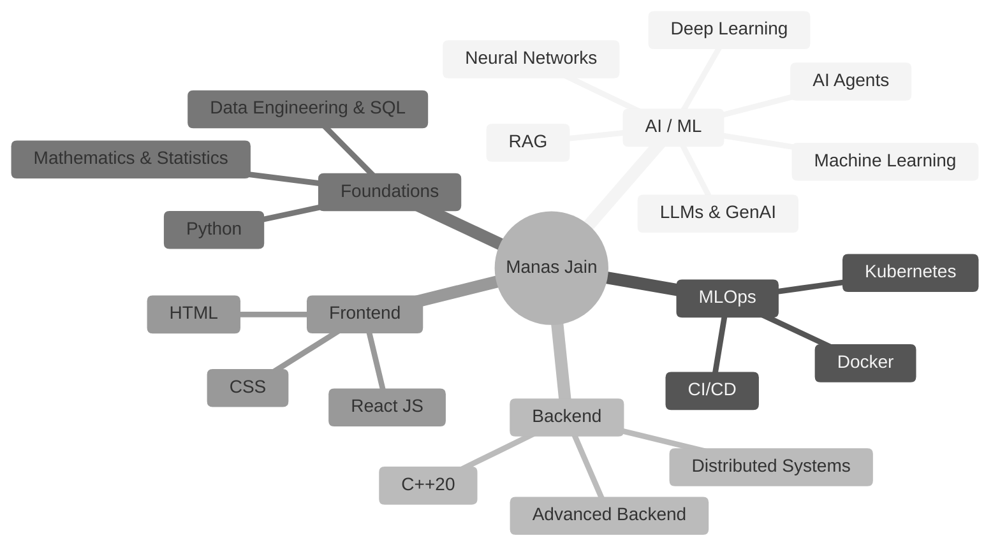

 

---

### 📰 &nbsp;The Front Page

> **Architecting high-performance systems & intelligent AI pipelines — from Indore.**
> Low-latency C++, LLM engineering, RAG architectures, and distributed systems that keep running even when servers crash.

- 🏛️ Honoured by the Mayor & Cabinet Minister for Indore's water-management solution (Hack'Ndore)
- ⚡ Technical Business Analyst (AI & Automation) at **Brain Inventory**
- 📄 Published research on **Zenodo** with a public DOI
- 🎤 Hosted the Mega **CEO Summit Podcast** · 8+ communication awards

---

### 🚀 &nbsp;Flagship Systems

| | Project | What it does |
|---|---|---|
| ⚙️ | **[Meridian](https://github.com/manasjainwork/meridian)** | Stock-exchange-style matching engine in **C++20**, replicated with **Raft** consensus, tested against thousands of simulated node and network failures. [📄 Zenodo DOI](https://doi.org/10.5281/zenodo.23856006) |
| 📬 | **Nectar** | Lead-gen & outreach platform: React 19 + Vite, Apps Script backend, AI enrichment via Groq (Llama 3.3 70B), Brevo dispatch. Zero server cost. |
| 🔗 | **ShortCraze** | Link-shortener SaaS with custom keywords, 30+ themes, QR codes. 70+ users, 400+ links in a month. |
| 🐶 | **Aashima AI** | AI "college senior" companion; chats are free, donations feed stray dogs. |
| 💧 | **Hack'Ndore** | IoT + AI water-distribution and leak-detection system for Indore, recognised by Govt. of MP. |

---

### 🛠️ &nbsp;Skills & Tech Stack

**AI / Machine Learning**
 

**LLMs, GenAI, RAG & Agents**
 

**MLOps**
 

**Advanced Backend & Systems**
 

**Languages, Data & Math**
 

**Frontend**
 

---

### 🧭 &nbsp;Skill Map

---

### 📫 &nbsp;Direct Correspondence

**Open to Software & AI Engineering roles, collaborations and speaking invites.**

[Portfolio](https://manasjainwork.github.io/Manas-j-Portfolio/) &nbsp;·&nbsp; [LinkedIn](https://www.linkedin.com/in/manas110) &nbsp;·&nbsp; [Email](mailto:contact.manasjain@gmail.com)

Indore, India · IST · remote-friendly

