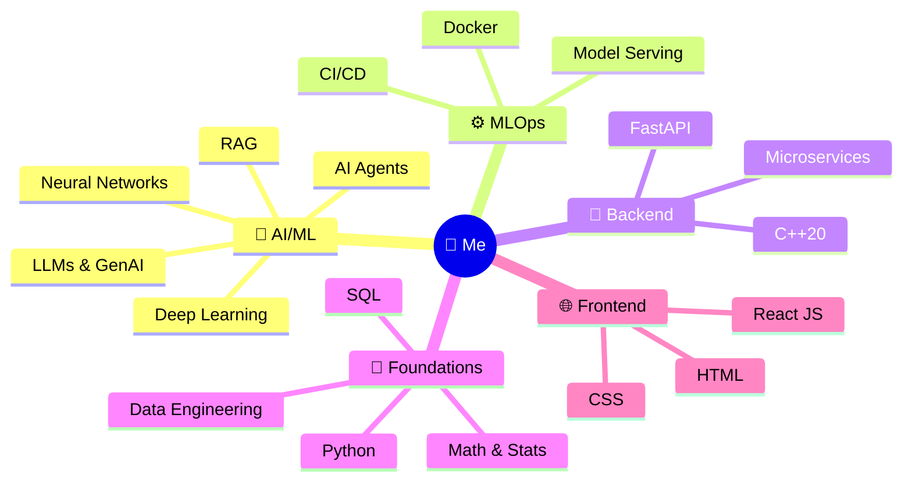

<!-- Replace YOUR_USERNAME and YOUR NAME everywhere -->

<div align="center">


<a href="https://git.io/typing-svg">
  
</a>

<br/>


</div>

---

## 👨‍💻 About Me

```python
class Developer:
    def __init__(self):
        self.name    = "YOUR NAME"
        self.role    = "AI/ML Engineer & Full Stack Developer"
        self.focus   = ["LLMs", "RAG", "AI Agents", "MLOps"]
        self.loves   = ["Math", "C++20", "Clean Backend", "Shipping Fast"]
        self.mission = "Build AI that actually works in production 🚀"

    def say_hi(self):
        print("Let's build something insane together! 🔥")
```

---

## 🛠️ Skills & Tech Stack

### 🤖 AI / Machine Learning
<p>
  
  
  
  
  
  
</p>

### 🧠 LLMs, GenAI, RAG & Agents
<p>
  
  
  
  
  
  
  
</p>

### ⚙️ MLOps
<p>
  
  
  
  
  
  
</p>

### 🧱 Advanced Backend
<p>
  
  
  
  
  
</p>

### 💻 Languages
<p>
  
  
  
  
</p>

### 📐 Mathematics & Data Engineering
<p>
  
  
  
  
  
  
</p>

### 🌐 Frontend
<p>
  
  
  
</p>

---

## 🧭 Skill Map



---

## 📊 GitHub Stats

<div align="center">


<br/>


<br/>


</div>

---

## 🏆 Trophies

<div align="center">

</div>

---

## 📫 Let's Connect

<div align="center">

[](https://linkedin.com/in/YOUR_USERNAME)
[](mailto:your@email.com)
[](https://twitter.com/YOUR_USERNAME)

<br/>

> *"Talk is cheap. Show me the model."* 😎


</div>
